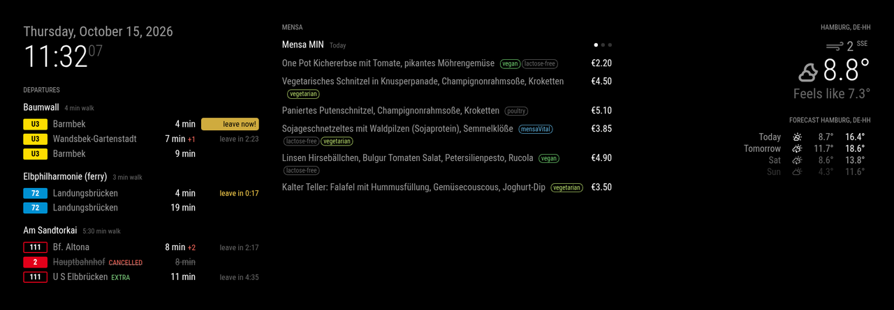
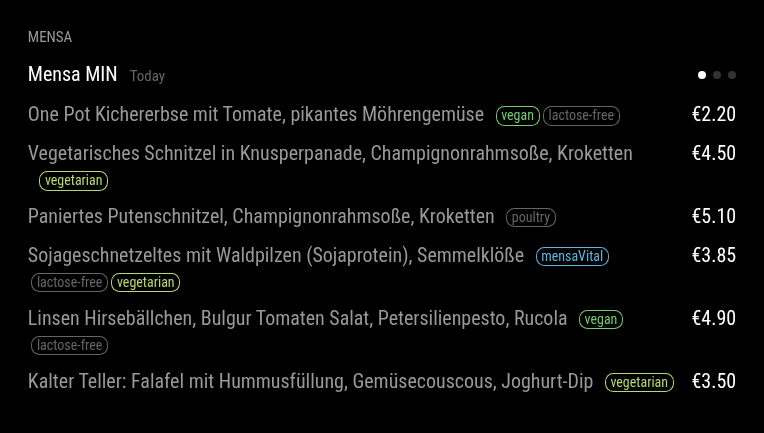

# MMM-HHMensa

What's for lunch today? The menus of the Hamburg university canteens (Studierendenwerk Hamburg)
for [MagicMirror²](https://magicmirror.builders/).



- **Your canteens**, chosen by name – one at a time, taking turns every 20 seconds
- **Daily recurring counters hidden** (pasta bar, vegetable bar) – configurable
- **Price** for students, employees or guests
- Optional **labels** (vegan, vegetarian, poultry, beef, pork, fish, mensaVital, lactose-free),
  **allergen codes** and **counter names** – all off by default
- From 17:00 on, the **next opening day** – skips weekends and holidays
- German and English, no external dependencies, light on the website (≤ 1 request per hour)

---

- [Installation](#installation)
- [Configuration](#configuration)
- [Where the data comes from](#where-the-data-comes-from)
- [Logging and troubleshooting](#logging-and-troubleshooting)
- [Development](#development)
- [Feedback & contributions](#feedback--contributions)

## Installation

```bash
cd ~/MagicMirror/modules
git clone https://github.com/FlorianSpanuth/MMM-HHMensa.git
```

No `npm install` needed.

## Configuration



```js
{
	module: "MMM-HHMensa",
	position: "top_center",
	header: "Mensa",
	config: {
		mensen: ["Mensa MIN", "Blattwerk", "Studierendenhaus"],
		showLabels: true // as in the screenshot; off by default
	}
}
```

| Option | Default | Description |
|---|---|---|
| `mensen` | `["Studierendenhaus"]` | Canteens to show, by name – case-insensitive, part of the name is enough. Unknown names are logged together with all available ones |
| `rotateInterval` | `20` | Seconds per canteen when several are configured; the dots show which one is on |
| `hideCategories` | `["Pastabar", "Gemüsebar"]` | Counters to hide; `[]` shows everything |
| `price` | `"students"` | `"students"`, `"employees"`, `"guests"` or `null` (no prices) |
| `showLabels` | `false` | Labels as small badges: vegan, vegetarian, poultry, beef, pork, fish, mensaVital, lactose-free |
| `showAllergens` | `false` | Allergen and additive codes below each dish |
| `showCategory` | `false` | Counter name above each dish ("CampusKlassiker", "Pottkieker", …) |
| `maxMeals` | `0` | Dishes per canteen, `0` = all |
| `switchTime` | `"17:00"` | From this time on, the next opening day is shown |
| `animationSpeed` | `1000` | Cross-fade in ms when switching canteens |

**Canteens** (October 2026): Mensa Studierendenhaus, Blattwerk, Mensa Philturm, Mensa MIN,
Mensa Botanischer Garten, Mensa Bucerius Law School, Mensa Berliner Tor, Mensa Finkenau, Mensa HCU,
Mensa Harburg, Mensa Bergedorf, Café CFEL, Café Jungiusstraße, Café (am Mittelweg),
Café Alexanderstraße, Café dell´Arte, Café ZessP, Schlüters (Pizza & More).

When there's nothing to show (e.g. closed), the module sends the notification
`MM2_CONTENT { hasContent: false }`, so a visibility manager can hide it or let another module take
its place.

## Where the data comes from

The Studierendenwerk Hamburg doesn't offer an API, and OpenMensa doesn't cover all canteens
(Mensa MIN, for example, is missing). The module therefore reads the public menu page
[stwhh.de/speiseplan](https://www.stwhh.de/speiseplan) – one page contains all canteens of a day.

- fetched at most once per hour during the day (every 3 hours at night), shared by all module instances
- before `switchTime` today's page, afterwards the "next opening day" page
- canteen and counter names are read from the page itself, so renamed or new canteens work
  without an update
- if a request fails, the last menu stays on screen

## Logging and troubleshooting

Messages go to MagicMirror's log (terminal, `pm2 logs` or `journalctl`), prefixed with `[MMM-HHMensa]`.

| Message | Meaning |
|---|---|
| `today: 111 dishes in 18 canteens (2026-10-15)` | Menu loaded |
| `canteen "X" not found. Available: …` | Check the name in `mensen` against the list |
| `no dishes found – page layout changed?` | The website changed – please [open an issue](https://github.com/FlorianSpanuth/MMM-HHMensa/issues) |
| `stwhh.de: HTTP …` / timeout | Website not reachable; the last menu stays, the module retries |

## Development

```bash
npm test   # parser tests against a trimmed copy of the real page (test/fixture.html)
```

## Feedback & contributions

I'd love to hear what you think – reviews, opinions, ideas and bug reports are all very welcome,
just [open an issue](https://github.com/FlorianSpanuth/MMM-HHMensa/issues). Pull requests are
welcome too, whether it's a small fix, a new feature or better docs.

## Credits

- Menu data: [Studierendenwerk Hamburg](https://www.stwhh.de/speiseplan)
- Screenshot: next to [MMM-HVV](https://github.com/FlorianSpanuth/MMM-HVV) (departures) and
  MagicMirror's clock and weather modules

## License

MIT
